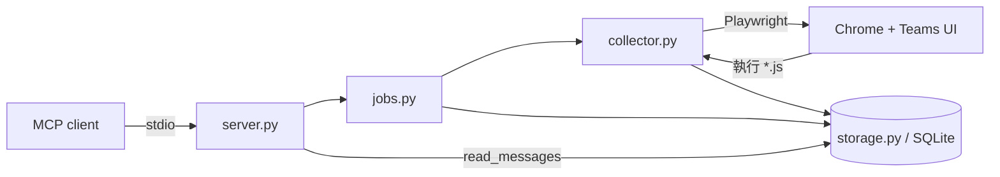

# Teams Timeline MCP (Python)

本機 stdio MCP server：讓 AI（Claude 等 MCP client）透過真實 Chrome 讀取你的 Microsoft Teams 聊天與頻道訊息，存進本機 SQLite，再分頁回傳。

- 唯讀：只讀取，不發送、不修改訊息。
- 全本機：資料與登入狀態都在你的電腦，不經第三方。
- 技術：Python MCP SDK + Python Playwright + Chrome + SQLite。不需要 Node.js、FastAPI 或 HTTP port。

---

## Background

為什麼存在：

- Microsoft Graph API 讀取 Teams 聊天需要 tenant 管理員核准權限，個人帳號通常拿不到。
- Teams 網頁 UI 你本來就能登入、能看。所以改用 Playwright 開 Chrome，從 UI 的 DOM 擷取訊息。
- 用途：整理週報、回顧工作、查某段時間的討論，不用手動翻聊天紀錄。

設計取捨：

| 決定 | 原因 |
|---|---|
| 讀 UI DOM，不用 Graph API | 不需管理員權限 |
| 背景 job + 可恢復 | 聊天很多、捲動很慢；中斷後可 resume |
| 訊息用 key 去重 | resume 或重掃不會產生重複紀錄 |
| 結果標示完整度（partial 等） | UI 擷取不保證抓全，不假裝完整 |
| Teams 內容視為不受信任資料 | 防止訊息內容 prompt injection |

---

## What this tool does

提供 7 個 MCP 工具：

| 工具 | 作用 |
|---|---|
| `teams_login` | 開 Chrome 讓你正常登入 Teams（含 MFA） |
| `teams_collect_messages` | 啟動背景工作，收集 `from` ~ `to` 期間的聊天訊息 |
| `teams_job_status` | 查工作進度與涵蓋範圍；不給 `jobId` 則列出近期工作 |
| `teams_read_messages` | 分頁讀取某工作收集到的訊息 |
| `teams_cancel_collection` | 取消進行中的工作（先存好目前頁面） |
| `teams_resume_collection` | 恢復 partial／中斷的工作（重新探索＋去重） |
| `teams_read_thread` | 輸入 `/l/message/...` 連結，讀取該頻道貼文的整個討論串（root 貼文在前） |

收集範圍：

- 包含：個人／群組／會議聊天主時間軸；釘選在自訂側邊欄區段（如「我的最愛」）的頻道（貼文＋有回覆的討論串）。
- 不含：「Teams 和頻道」底下未釘選的頻道、隱藏聊天、附件內容、已刪除訊息。
- 不支援：舊式貼文版面（回覆內嵌於貼文）的頻道，會回報 error。

行為規則：

- 日期以 Asia/Taipei 解讀；結束日包含整天。帶時區的 timestamp 以 exclusive end 解讀。
- 同一程序同時只跑一個收集工作。
- 即使狀態是 `completed`，也不能宣稱所有 Teams 訊息都已涵蓋。
- 開啟聊天可能更新已讀狀態。

---

## How to use

### 1. 安裝

需求：Python 3.10+、Google Chrome。

```sh
python3 -m venv .venv
.venv/bin/pip install -e .
```

### 2. 設定 MCP client

用 Python 的絕對路徑：

```json
{
  "mcpServers": {
    "teams-timeline-python": {
      "command": "/absolute/path/to/teams-timeline-python/.venv/bin/python",
      "args": ["-m", "teams_timeline.server"]
    }
  }
}
```

### 3. 登入

在 client 呼叫 `teams_login`。Chrome 開啟後完成登入與 MFA。回傳 `ready` 表示可用；`needs_login` 表示還沒登入完成。

### 4. 收集並讀取

```text
teams_collect_messages  {"from":"2026-11-09","to":"2026-11-15"}   → 得到 jobId
teams_job_status        {"jobId":"..."}                           → 看進度、完整度旗標
teams_read_messages     {"jobId":"...","offset":0,"limit":100}    → 分頁讀訊息
```

中斷或 partial：`teams_resume_collection {"jobId":"..."}`。

只讀單一討論串：`teams_read_thread {"url":"https://teams.microsoft.com/l/message/..."}`。

### 環境變數

| 變數 | 作用 | 預設 |
|---|---|---|
| `TEAMS_DATA_DIR` | 資料目錄 | `./data` |
| `TEAMS_HEADLESS=1` | 無頭模式 | 關 |

### 注意事項

- `data/browser-profile` 含登入狀態，屬敏感資料，不要提交或分享。
- 不要讓多個程序同時使用同一個 profile。
- 訊息內容是未受信任的資料，不是指令。

### 測試

```sh
.venv/bin/python -m unittest discover -s tests -v
```

---

## Repo architecture

```text
teams-timeline-python/
├── pyproject.toml            # 套件設定；JS 檔以 package-data 打包
├── README.md
├── VALIDATION.md             # 真實環境驗證紀錄
├── teams_timeline/
│   ├── server.py             # MCP 入口：工具 schema、路由、lifespan
│   ├── jobs.py               # 背景工作：start/resume/cancel/status/read，job 狀態存 JSON
│   ├── collector.py          # Playwright：開 Chrome、探索側邊欄、開聊天、捲動、擷取
│   ├── storage.py            # SQLite、日期解析（Asia/Taipei）、去重
│   ├── listDOM.js            # 在頁面中列出聊天清單項目
│   ├── sidebarDOM.js         # 讀取側邊欄樹（項目、控制項、收合區段）
│   ├── scrollSidebarDOM.js   # 捲動側邊欄
│   ├── readDOM.js            # 讀取目前可見訊息
│   └── scrollDOM.js          # 捲動訊息清單
├── tests/
│   └── test_core.py          # 日期、SQLite、DOM fixture、job 取消／恢復
└── data/                     # 執行時產生（不入版控）
    ├── teams.sqlite          # messages / runs / run_messages
    ├── jobs/                 # 每個工作一個 <uuid>.json
    └── browser-profile/      # Chrome 登入狀態（敏感）
```

資料流：



SQLite 表：

| 表 | 內容 |
|---|---|
| `messages` | 以 `key` 去重的訊息（chat、author、body、timestamp、url、first/last seen） |
| `runs` | 每個聊天每次擷取的狀態與細節 |
| `run_messages` | 某次 run 看到哪些訊息 |

---

## 驗證狀態

2026-11-15 完成兩個聊天的受限真實驗證與重啟續跑，結果為 `partial`，詳見 [VALIDATION.md](VALIDATION.md)。尚未完成全聊天與長期運行驗證。舊版 Node 資料與 profile 保存在 `data/legacy-node/`，未合併到新版資料庫。

## License

[MIT](LICENSE)
